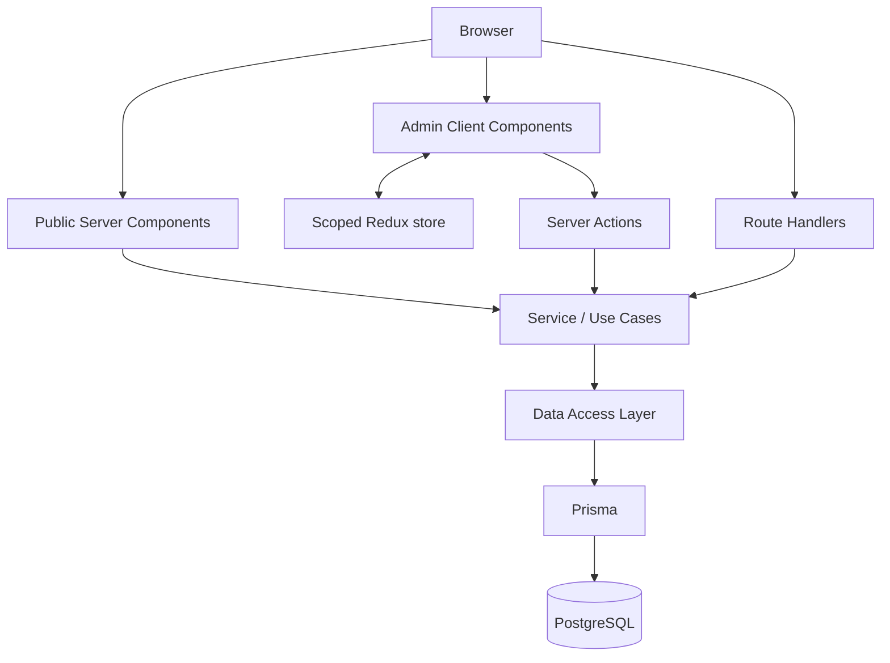

# Next.js Blog Platform

> A design-led publishing platform built with the Next.js App Router, PostgreSQL, Prisma, and a deliberately scoped Redux admin workspace.

`nextjs-blog-platform` は、完成版MERN Blogの画面・機能を参考に、Next.js App Routerで再設計・実装するポートフォリオプロジェクトです。このディレクトリを独立したGitHubリポジトリとして使用します。

## Project status

**Planning complete / implementation not started**

- Demo: `TBD`
- Repository: [github.com/Yunnashi/nextjs-blog-platform](https://github.com/Yunnashi/nextjs-blog-platform)
- Design: `TBD`
- Target development period: 4 weeks / 120 focused hours

## Source of reference

画面、機能、ユーザーフローは、現在の参考プロジェクト資料を基準にしています。

- [Reference project audit](docs/REFERENCE_AUDIT.md)
- [Product specification](docs/PRODUCT_SPEC.md)
- [Architecture](docs/ARCHITECTURE.md)
- [Architecture decisions](docs/DECISIONS.md)

参考版から引き継ぐのは、Home、検索、記事詳細、認証、コメント、プロフィール、記事管理、ユーザー管理、コメント管理、dark modeなどのプロダクト体験です。React SPA、Express、MongoDB、client-side fetchingの実装は移植せず、Next.js App Router向けに再設計します。

## Project objective

目標は、単にブログをNext.jsで作り直すことではありません。

> 5年のフロントエンド経験にふさわしい、設計判断、UI品質、アクセシビリティ、テスト、パフォーマンスを説明できる完成品を作る。バックエンドはNext.jsのserver-side機能、Prisma、PostgreSQLで成立させる。

重点配分：

| Area | Target allocation |
|---|---:|
| UI / UX / accessibility | 30% |
| React / Next.js architecture | 25% |
| Test / quality assurance | 15% |
| Performance measurement | 15% |
| PostgreSQL / Prisma / authentication | 15% |

## Final architecture decision

```text
Next.js App Router
├── Public experience
│   └── Server Components
│
├── Admin experience
│   ├── Client Components
│   ├── Redux Toolkit
│   ├── editorSlice
│   └── uiSlice
│
├── Server Actions
├── Route Handlers
├── Service / Use Case
├── Data Access Layer
├── Prisma
└── PostgreSQL
```



設計の詳細は [System design](docs/DESIGN.md) と [Architecture](docs/ARCHITECTURE.md) を参照してください。

## Why Next.js without a separate backend?

このブログでは、独立したNestJS / Express APIを置きません。

- 公開記事をServer Componentsでserver-side renderingできる
- Server Actionsで内部フォームmutationを完結できる
- Route HandlersでWebhookやupload endpointだけを提供できる
- browser → API → databaseという不要なself-HTTPを避けられる
- 同一repository / deployment内で型、cache invalidation、認証を管理できる
- Next.jsのserver-side機能を深く学ぶという目的に合う

Service / Use CaseとDALを分けることで、Next.jsのfile conventionにbusiness ruleやPrisma queryを散らしません。

## Technology choices

| Area | Choice | Reason |
|---|---|---|
| Framework | Next.js App Router + TypeScript | Server Components、Actions、Route Handlers、metadata、streamingを一つの構成で学ぶ |
| Client state | Redux Toolkit | 管理画面のeditor workflowと横断UI stateを明示的に管理する |
| Database | PostgreSQL | relation、constraint、transaction、index、searchを設計として示す |
| ORM | Prisma | typed query、migration、schema review |
| Validation | Zod | Server Action / Route Handlerのuntrusted inputをserver-sideで検証する |
| Forms | React Hook Form | client validationとaccessible form state。serverでも必ず再検証する |
| Styling | Tailwind CSS + CSS custom properties | 独自tokenとresponsive UI |
| UI primitives | Accessible headless primitivesを必要箇所だけ | Dialog / Menu / Comboboxの操作品質を確保する |
| Content | Markdown + controlled renderer | 任意HTMLを避け、技術記事とcode blockに適合する |
| Tests | Vitest + Testing Library + Playwright | reducer、use case、component、critical journeyを分けて検証する |
| CI | GitHub Actions | lint、typecheck、test、build、migration check |

バージョンはscaffold時のstableを確認し、exact versionとlockfileをcommitします。Next.jsのcache APIとPrisma migrationはmajor version差が大きいため、実装時の公式資料を基準にします。

## Core features

### Public experience

- Home: hero、featured、最新記事、topics、portfolio CTA
- article list: keyword、category、tag、sort、cursor pagination
- article detail: metadata、目次、読了時間、code block、関連記事
- About / Work / Case studies
- light / dark / system theme
- loading / empty / error / not-found states

### Reader experience

- sign in / sign out
- profile update
- comment create / delete
- comment reaction

### Author / admin experience

- overview totals
- Draft / Preview / Publish / Archive
- Markdown editor、cover、category、tags、SEO metadata
- post management
- user management
- comment moderation

## Redux scope

Redux Providerはroot layoutではなく、原則として`/admin` subtreeに限定します。

### `editorSlice`

- active draft buffer
- dirty state
- preview mode
- autosave status / last saved time
- editor historyなど、実際に必要になった横断状態

### `uiSlice`

- admin sidebar
- confirmation dialog
- table selection / bulk action
- admin view preferences

Reduxに保存しないもの：

- session token / authenticated userの正本
- 公開記事一覧
- URLで表現できる検索条件
- Prisma result全体
- Server Actionの機密エラー情報

## Server Actions and Route Handlers

### Server Actions

Next.js UI内部から呼ぶmutation：

- sign in / sign out
- profile update
- draft save
- publish / archive
- comment create / delete
- user / comment moderation

### Route Handlers

HTTP endpointが必要な処理だけ：

- signed image upload
- external webhook
- health endpoint
- OG imageなどHTTP response自体が成果物になる処理
- 将来の外部client API

同じmutationをActionとRoute Handlerに重複実装しません。どちらも共通Use Caseを呼びます。

## Proposed repository structure

```text
.
├── src/
│   ├── app/
│   │   ├── (public)/
│   │   ├── admin/
│   │   ├── api/
│   │   └── layout.tsx
│   ├── components/
│   ├── features/
│   │   ├── articles/
│   │   ├── comments/
│   │   └── editor/
│   ├── store/
│   │   ├── store.ts
│   │   ├── editor-slice.ts
│   │   └── ui-slice.ts
│   └── server/
│       ├── actions/
│       ├── auth/
│       ├── use-cases/
│       ├── dal/
│       └── validation/
├── prisma/
│   ├── migrations/
│   ├── schema.prisma
│   └── seed.ts
├── tests/
│   ├── integration/
│   └── e2e/
├── docs/
│   ├── adr/
│   └── measurements/
└── .github/workflows/
```

実際のPrisma major versionでschema / contract layoutが変わる場合は、公式scaffoldに従って構造を更新します。

## Quality targets

| Area | Initial target |
|---|---:|
| LCP | p75 <= 2.5 s |
| INP | p75 <= 200 ms |
| CLS | p75 <= 0.1 |
| Accessibility | critical axe violation 0 + keyboard manual check |
| Article query | p95 <= 300 ms with documented seed |
| CI | lint / typecheck / test / build all required |

数値はpreview / production相当環境で測定し、device、network、dataset、tool versionを記録します。

## First vertical slice

```text
Author sign in
→ Draft create
→ PostgreSQL save
→ Preview
→ Publish transaction
→ Cache revalidation
→ Public Server Component render
→ E2E test
```

この縦切りがproduction qualityで通るまで、コメント、analytics、advanced searchへ広げません。

## Documentation

- [System design](docs/DESIGN.md)
- [Product specification](docs/PRODUCT_SPEC.md)
- [Architecture and data design](docs/ARCHITECTURE.md)
- [Architecture decisions](docs/DECISIONS.md)
- [4-week study and implementation roadmap](docs/ROADMAP.md)
- [Reference project audit](docs/REFERENCE_AUDIT.md)
- [Official references](docs/REFERENCES.md)

## Local development placeholder

実装後、clean checkoutで確認したcommandだけを確定します。

```bash
pnpm install
pnpm db:up
pnpm db:migrate
pnpm db:seed
pnpm dev
```

- App: `http://localhost:3000`

## License

TBD
