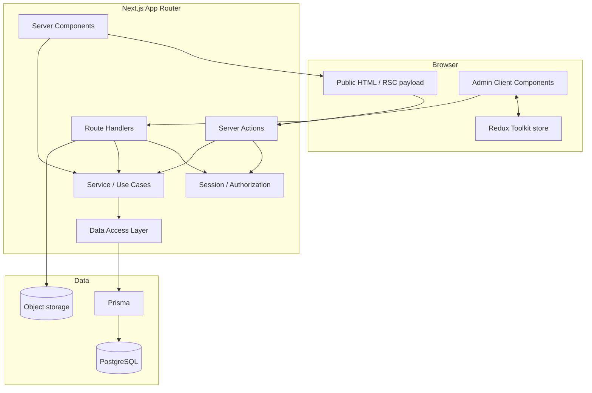
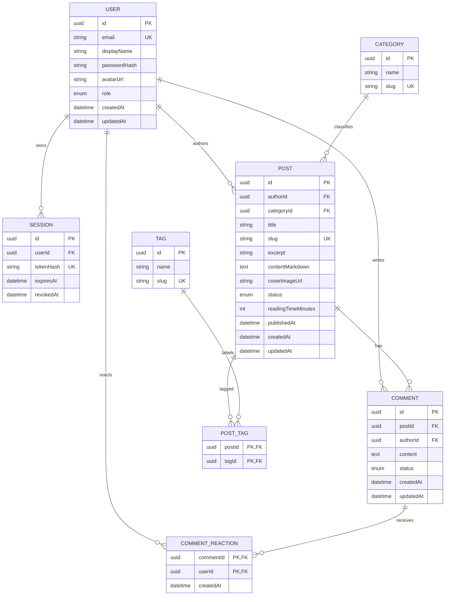

# Architecture and data design

## 1. Architecture principles

1. 公開画面はServer Componentsを既定にする。
2. Client Componentはinteraction、browser API、Reduxが必要な境界だけにする。
3. Server Actions / Route Handlersをbusiness logic置き場にしない。
4. business ruleはService / Use Caseへ置く。
5. PrismaはDALからだけ呼ぶ。
6. authorizationはroute非表示だけでなく、Use Case / DAL境界でも確認する。
7. public cacheとprivate dataを混ぜない。

## 2. Container view



## 3. Request paths

### Public read

```text
Request
→ Server Component
→ Query Use Case
→ DAL
→ Prisma
→ PostgreSQL
→ cached / streamed server output
```

Server Componentから自アプリのRoute HandlerへHTTP fetchしません。同一process内のUse Caseを直接呼びます。

### Internal mutation

```text
Client form
→ Server Action
→ parse + Zod validation
→ authenticate / authorize
→ Command Use Case
→ DAL / Prisma transaction
→ revalidatePath / revalidateTag
→ typed result
```

### External HTTP request

```text
External service / upload client
→ Route Handler
→ request validation / auth
→ Use Case
→ DAL or object storage
→ HTTP response
```

## 4. Rendering policy

| Area | Component model | Data policy |
|---|---|---|
| Home | Server Component | cached published content |
| Article list | Server Component | URL search params、server query |
| Article detail | Server Component | cached by slug、metadata generated server-side |
| About / Work | Server Component | static or repository content |
| Theme toggle / mobile menu | Client Component | small local state |
| Comment form / reaction | Client Component island | Server Action + optimistic feedback |
| Admin layout | Server Component boundary | session / role check、no shared cache |
| Admin tables | Server-first + Client controls | dynamic private query |
| Editor workspace | Client Component | Redux editor state + Server Actions |

`use client`をpage rootへ機械的に置かず、client module graphを小さく保ちます。

## 5. Layer responsibilities

### App Router layer

- route、layout、metadata、loading、error、not-found
- Server / Client Componentのcomposition
- requestからsearch paramsやform dataを受け取る
- business ruleを実装しない

### Server Actions

- UIからのmutation entry point
- untrusted inputのparse / validation
- session取得
- Use Case呼び出し
- expected errorをserializable resultへ変換
- mutation成功後のrevalidation / redirect

### Route Handlers

- HTTP method / status / header / body
- webhook signature、upload authorization
- public APIが必要になった場合のboundary
- Use Caseを呼び、Prismaを直接呼ばない

### Service / Use Case

- `CreateDraft`
- `UpdateDraft`
- `PublishPost`
- `ArchivePost`
- `CreateComment`
- `ModerateComment`
- `UpdateProfile`
- authorization policyとtransaction boundary

Use CaseはNext.jsの`Request`、`Response`、React、Reduxに依存しません。

### Data Access Layer

- query selectionとPrisma mapping
- 必要最小限のfieldだけ返すDTO
- owner / published statusなどのdata-level filtering
- cursor、indexを意識したquery
- Prisma errorをapplication errorへ変換

DALとauth helperは`server-only`でclient importを防ぎます。

## 6. Admin Redux architecture

Redux Providerは`app/admin`配下へ限定します。StoreはClient Componentでrequestごとに初期化し、module-level singletonをserverで共有しません。

```text
AdminStore
├── editor
│   ├── draftId
│   ├── buffer
│   ├── dirtyFields
│   ├── previewMode
│   ├── saveStatus
│   └── lastSavedAt
└── ui
    ├── sidebarOpen
    ├── activeDialog
    ├── selectedRowIds
    └── tableDensity
```

### Source-of-truth rule

- PostgreSQL: 保存済みdraftの正本
- Redux: 現在のeditor sessionの作業状態
- URL: search / filter / tab / pagination
- server session: authenticated user / role
- component local state: そのcomponentだけの一時状態

Redux Persistでsession tokenやdraft本文を無条件にlocalStorageへ保存しません。offline draftを実装する場合はsecurity / conflict policyを別ADRにします。

## 7. Authentication and authorization

maintained auth libraryの採用を優先し、custom cryptographyを目的にしません。

```text
Sign in
→ credential / provider verification
→ server session creation
→ HttpOnly + Secure + SameSite cookie
→ server-side session read
→ role / ownership authorization
```

role：

- `READER`: public read、own comment
- `AUTHOR`: reader + own post create / update / publish / archive
- `ADMIN`: all post、user、comment moderation

UIでbuttonを隠すだけではなく、すべてのServer Action / Route Handler / Use Caseで認可します。clientから渡された`userId`をownershipの根拠にしません。

## 8. Data model



### Constraints and indexes

- `User.email`, `Post.slug`, `Category.slug`, `Tag.slug`: unique
- `Post(status, publishedAt DESC, id)`: public list cursor
- `Post(authorId, status, updatedAt DESC)`: admin list
- `Comment(postId, status, createdAt DESC)`: article comments
- `Session(tokenHash)`, `Session(userId, expiresAt)`: session lookup / cleanup
- `PostTag(postId, tagId)`: composite unique
- `CommentReaction(commentId, userId)`: composite unique
- foreign keyのdelete policyを各relationで明示

## 9. Publication transaction

`PublishPost` Use Case：

1. session userを取得
2. AUTHOR / ADMIN roleとownershipを確認
3. publish schemaでtitle、slug、content、categoryを検証
4. unique slugをDB constraintで保証
5. transaction内でstatusと`publishedAt`を更新
6. commit後にarticle / list cacheをrevalidate
7. public URLを返す

DB commit後のrevalidation失敗でpublication自体をrollbackしません。cache TTLとretry可能な運用手順を持ちます。

## 10. Search and pagination

1. MVPはtitle / excerptのcase-insensitive search。
2. `q`, `category`, `tag`, `sort`, `cursor`をURL source of truthにする。
3. `publishedAt + id`のdeterministic cursorを使う。
4. 日本語・英語を含む10,000件seedで`EXPLAIN ANALYZE`を保存する。
5. 必要なら`pg_trgm` + GIN indexをSQL migrationで追加する。

## 11. Caching

- public home / article list / article detail: cache candidate
- preview / admin / personalized data: shared cache禁止
- publish / update / archive: affected tag / pathをrevalidate
- mutation後にbrowserへ古いRedux server dataを正本として残さない
- Next.js versionごとのcache modelは実装時に公式資料で固定する

## 12. Error model

```ts
type ActionResult<T> =
  | { ok: true; data: T }
  | {
      ok: false;
      code: 'VALIDATION' | 'UNAUTHORIZED' | 'FORBIDDEN' | 'CONFLICT' | 'UNKNOWN';
      message: string;
      fieldErrors?: Record<string, string[]>;
    };
```

expected errorはfield / form errorとして表示し、unexpected errorはerror boundaryとserver logへ送ります。DB詳細、stack、secretをclientへ返しません。

## 13. Environments and deployment

### Local development

```text
Host machine
├── Next.js (`pnpm dev`)
├── Prisma CLI / migration / seed
└── Docker Compose
    └── PostgreSQL
```

- ローカルのPostgreSQLは`compose.yml`で起動する
- PostgreSQL image version、port、database name、health check、persistent volumeをComposeで管理する
- Next.jsはcontainer化せず、ホスト上で起動して開発時のfeedback loopを短くする
- integration test用databaseはdevelopment databaseと分離する
- `.env.example`には接続形式だけを記載し、credentialはcommitしない

### Production

```text
CDN / Next.js runtime
├── App Router rendering
├── Server Actions
├── Route Handlers
├── Use Cases / DAL / Prisma
├── managed PostgreSQL
└── object storage
```

本番ではDocker Composeを使用せず、managed PostgreSQLを採用します。webとbackendを別serviceに分けないためCORSは通常不要です。databaseとNext.js runtimeは同一regionを優先し、migrationはdeploy前後の専用jobで実行します。
