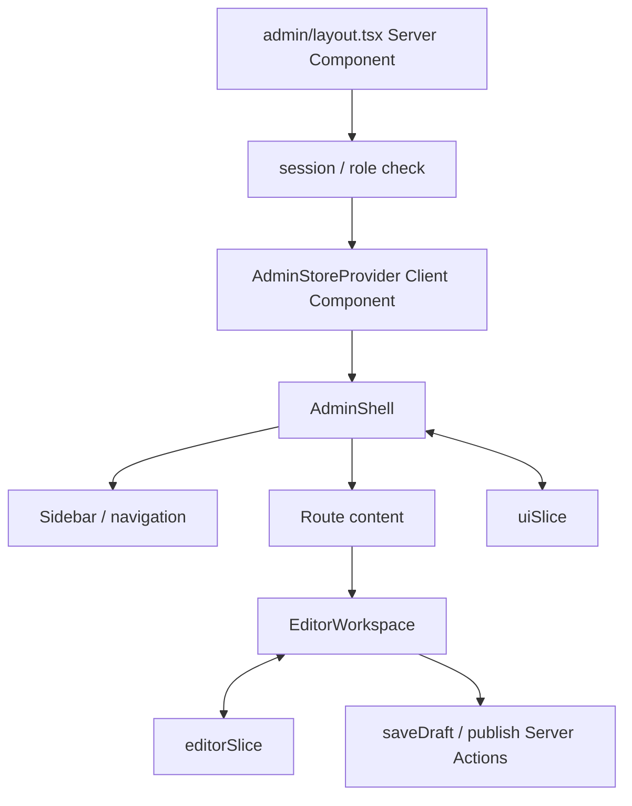
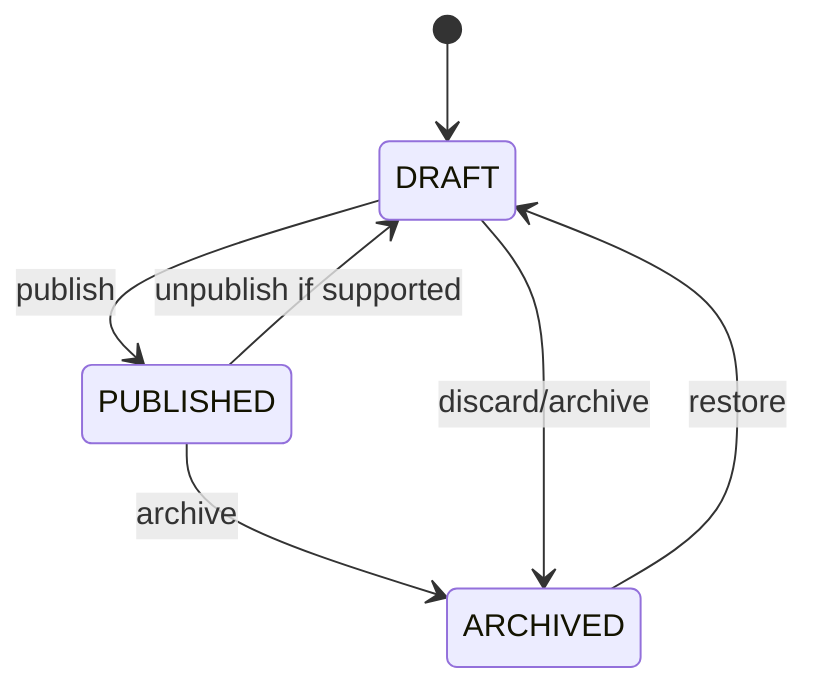

# System design specification

## 1. Scope

### MVP

- Home、article list、article detail、About、Work
- sign in / sign out
- admin overview
- Draft create / edit / preview / publish / archive
- category / tag / search
- profile update
- responsive、dark mode、主要error states
- publish E2Eと主要integration tests

### Post-MVP

- reader registration
- comments / reactions
- user management
- comment moderation
- autosave / editor history
- advanced search / performance experiment

## 2. Route design

```text
src/app/
├── (public)/
│   ├── page.tsx
│   ├── articles/page.tsx
│   ├── articles/[slug]/page.tsx
│   ├── about/page.tsx
│   └── work/page.tsx
├── (auth)/
│   └── sign-in/page.tsx
├── admin/
│   ├── layout.tsx
│   ├── page.tsx
│   ├── posts/page.tsx
│   ├── posts/new/page.tsx
│   ├── posts/[id]/edit/page.tsx
│   ├── comments/page.tsx
│   ├── users/page.tsx
│   └── settings/page.tsx
├── api/
│   ├── uploads/route.ts
│   ├── webhooks/[provider]/route.ts
│   └── health/route.ts
├── error.tsx
├── not-found.tsx
└── layout.tsx
```

## 3. Screen specification

| Screen | Reference | New rendering | Main change |
|---|---|---|---|
| Home | `/` | Server Component | featured / recentをserver render |
| Search | `/search` | `/articles` Server Component | URL paramsとcursor query |
| Article | `/post/:slug` | `/articles/[slug]` Server Component | metadata、TOC、安全なMarkdown |
| About | `/about` | Server Component | personal brand用に更新 |
| Projects | `/projects` | `/work` Server Component | case study一覧へ発展 |
| Sign in | `/sign-in` | server page + client form | server session、Action validation |
| Dashboard | query tab | nested admin routes | URLとrouteで責務を分離 |
| Create / Update | separate SPA pages | editor Client Component | draft / preview / publish workflow |

詳細UI要件は [Product specification](PRODUCT_SPEC.md) を参照してください。

## 4. Admin composition



serverから渡すinitial draftは必要なfieldだけserializeし、Provider initializationで一度だけReduxへ取り込みます。route navigationで別draftへ移動した場合のstore reset policyをtestします。

## 5. Feature modules

```text
src/features/articles/
├── components/
├── schemas/
├── types/
└── mappers/

src/server/
├── actions/
│   ├── auth-actions.ts
│   ├── post-actions.ts
│   └── comment-actions.ts
├── use-cases/
│   ├── posts/
│   ├── comments/
│   └── users/
├── dal/
│   ├── post-dal.ts
│   ├── comment-dal.ts
│   └── user-dal.ts
└── auth/
```

依存方向：

```text
UI / Action / Route Handler
            ↓
       Use Case
            ↓
          DAL
            ↓
        Prisma
```

下位layerから上位layerをimportしません。

## 6. Core use cases

| Use Case | Input | Authorization | Output |
|---|---|---|---|
| ListPublishedPosts | search / cursor | Public | public post summaries |
| GetPublishedPost | slug | Public | sanitized public post |
| CreateDraft | draft input | AUTHOR+ | draft id / version |
| UpdateDraft | id / version / changes | Owner/Admin | updated snapshot |
| PublishPost | id / expected version | Owner/Admin | slug / publishedAt |
| ArchivePost | id | Owner/Admin | archived status |
| CreateComment | post / content | READER+ | visible/pending comment |
| ModerateComment | comment / decision | ADMIN | moderation result |
| UpdateProfile | profile input | Current user | safe profile |

concurrent editor updateには`updatedAt`またはversion fieldを使い、古いdraftで上書きする場合は409相当のconflictを返します。

## 7. Validation policy

- Client: 即時feedback。security boundaryではない。
- Server Action / Route Handler: Zodで全inputを再検証。
- Use Case: role、ownership、state transitionなどbusiness rule。
- Database: unique、not null、foreign key、composite constraint。

## 8. State transitions



初回publishで`publishedAt`を設定し、通常のupdateでは保持します。再公開policyは実装前にADRで確定します。

## 9. Test design

### Unit

- Redux reducer / selector
- slug、reading time、cursor encode/decode
- state transition / authorization policy
- Markdown transform

### Integration

- Use Case + test PostgreSQL
- Prisma constraint / transaction
- session authorization
- publish + cache invalidation boundary

### Component

- editor fields、preview toggle、dirty warning
- search filters、dialog、error recovery
- keyboard / focus behavior

### E2E

1. search → article read
2. author sign in → draft → preview → publish
3. edit conflict / validation recovery
4. reader comment → owner delete
5. unauthorized admin access rejection

## 10. Definition of done

- acceptance criteriaを満たす
- loading / empty / error / successを確認
- mobile / desktop / keyboardを確認
- server validation / authorizationがある
- appropriate testまたはtestしない理由がある
- private dataがRSC payload / Redux / logへ漏れない
- mutation後のcache / UI consistencyを確認
- docsと実装が同期している
